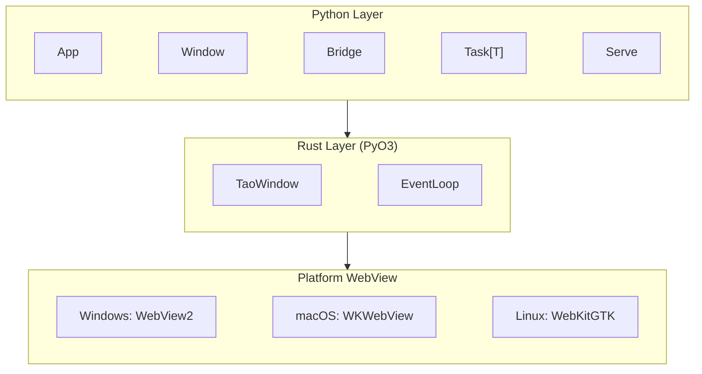

<p align="center">
  <h1 align="center">LumiView</h1>
  <p align="center">
    <strong>Pythonic webview desktop app framework — lightweight, out-of-the-box, async-first.</strong>
  </p>
  <p align="center">
    <a href="https://pypi.org/project/lumiview/"></a>
    <a href="https://pypi.org/project/lumiview/"></a>
    <a href="https://github.com/xiaosuawa/LumiView/blob/main/LICENSE"></a>
    <a href="https://github.com/xiaosuawa/LumiView/actions/workflows/test.yml"></a>
  </p>
  <p align="center">
    <a href="README_zh.md">中文</a>
  </p>
</p>

---

> ⚠️ **Early Development Stage — APIs May Change**
>
> LumiView is currently in **alpha**. The API is functional but **not yet fully stable** — method names, parameter structures, and import paths may still change between releases. We use alpha releases to gather early feedback while retaining the flexibility to adjust the API.
>
> **Early adopters welcome!** Try building an app with it and tell us what works well and what doesn't. Your feedback will directly shape the final stable API. When upgrading, please check the release notes and be prepared to adjust your code.

---

## What is LumiView?

LumiView is an app development framework focused on system webviews. At the core layer, it wraps [tao](https://github.com/tauri-apps/tao) and wry (via [wryview](https://github.com/xiaosuawa/wryview)); at the top layer, it provides a clean, out-of-the-box, async-first Python API.

### Architecture



**Threading model:** Main thread (event loop + native ops) → Async thread (asyncio + user coroutines) → Thread pool (synchronous code).

## Documentation

Start with the [documentation index](docs/README.md) and its three-minute mental model, then dive into a chapter:

- [Getting Started](docs/getting-started.md) — installation, minimal async/sync apps, `WindowOptions`, multi-window contexts and logging
- [Architecture & Concurrency](docs/architecture-and-concurrency.md) — layered design, threading, `Task[T]`, deadlock protection and third-party GUI integration
- [Lifecycle & Events](docs/lifecycle-and-events.md) — `AppState`, two-phase shutdown, preventable events and one-shot waits
- [Windows & Native Appearance](docs/window-and-appearance.md) — geometry, frameless titlebars, native effects and WebView capabilities
- [JS ↔ Python Communication](docs/bridge-and-js-client.md) — the Bridge, `window.__LUMIVIEW__`, typed commands and secure modes
- [Plugins & Permissions](docs/plugins-and-permissions.md) — `Scope` trees, `ScopePermission` chains and custom plugins
- [Serve Protocols](docs/serve-protocols.md) — `Static`, `Handler`, `WSGI` and `ASGI` over `lumiview://`
- [Native Menus & Tray](docs/menus-and-tray.md) — menu trees, accelerators, tray icons and close-to-tray

> Chinese translations live next to the English docs (`docs/*.zh.md`), starting with the
> [文档导航](docs/README.zh.md).

## Installation

```bash
pip install lumiview
```

## Quick Start

```python
from lumiview import App, Window, WindowOptions

app = App(name="HelloLumiView")

async def main():
    win = await Window.create(WindowOptions(
        title="Hello LumiView!",
        url="https://example.com",
        width=900, height=640,
        devtools=True,
    ))
    await win.wait_loaded()          # PageLoadFinishedEvent, race-free
    title = await win.eval_js("document.title")
    print(f"Page title: {title}")

app.run(main)
```

## Key Features

- **🧵 Unified async/sync** — All cross-thread / async operations return `Task`. `await`, `.result()`, or `.on_done()` — same API, your choice.
- **⏳ Event filters & one-shot waits** — `where=` predicates, `wait_for()` / `wait_loaded()`, cancellable `Subscription`s, and `WindowEvent.JsEvent` for page-to-Python notifications.
- **🌉 JS ↔ Python Bridge** — Expose Python functions to JS via `window.__LUMIVIEW__.invoke()`. No HTTP server, no manual serialization required. A typed facade for bundled frontends lives in `js/` (not published to npm yet).
- **🪟 Native window effects** — Acrylic, Mica, Vibrancy via `window-vibrancy`.
- **🎨 Custom titlebar** — Declarative `data-lumiview-drag-region` drag areas + built-in `__LUMIVIEW__.plugins.window.*` JS API (minimize / maximize / close).
- **📋 Native menus** — Per-item `on_activate` callbacks + global `MenuItemActivatedEvent`; macOS default app menu installed automatically, window menu bars on Windows.
- **🎛️ System tray** — Cross-platform tray icons with context menus and click events; close-to-tray pattern.
- **📁 Static serving & WSGI & ASGI** — Directly load local files, proxy to WSGI apps (Flask, Django, etc.), or run FastAPI/Starlette apps without external servers.

## Logging

LumiView logs to the `lumiview` logger tree using the standard
`logging` configuration. To see internal diagnostics, raise the level of
the `lumiview` logger:

```python
import logging

logging.getLogger("lumiview").setLevel(logging.INFO)   # lifecycle events
logging.getLogger("lumiview").setLevel(logging.DEBUG)  # + scheduling / dispatch
```

When reporting a bug, please include the DEBUG log output — it usually
pinpoints the issue. See [CONTRIBUTING.md](CONTRIBUTING.md#-bug-reports).

For runnable code, see the [`examples/`](examples/) directory.

## Examples

| Example | Description |
|---|---|
| [`hello_world.py`](examples/hello_world.py) | Minimal app — create window, `wait_loaded()`, load URL (async) |
| [`hello_world_sync.py`](examples/hello_world_sync.py) | Same as above, using `.result()` — pure synchronous style |
| [`bridge_demo.py`](examples/bridge_demo.py) | JS ↔ Python IPC — sync/async commands, error handling |
| [`multi_window.py`](examples/multi_window.py) | Multi-window + shared WebContext + app window registry |
| [`custom_titlebar.py`](examples/custom_titlebar.py) | Frameless window + native effects + drag regions |
| [`events.py`](examples/events.py) | App/Window events, JS→Python `JsEvent`, one-shot waits, Python→JS `emit` |
| [`fastapi_demo.py`](examples/fastapi_demo.py) | FastAPI running via `source=ASGI(...)` |
| [`django_demo.py`](examples/django_demo.py) | Django running via `source=WSGI(...)` — template rendering, form POST, JSON APIs |
| [`menu.py`](examples/menu.py) | Native menus — accelerators, `on_activate` callbacks, macOS app menu / Windows window menu bar |
| [`tray.py`](examples/tray.py) | System tray — close-to-tray pattern, tray context menu |

## Development Status

- [x] Window management (TaoWindow + Window)
- [x] WebView embedding (wryview)
- [x] JS ↔ Python Bridge (invoke/emit/listen IPC)
- [x] TypeScript page client (`js/`); npm publishing pending
- [x] Event class system (WindowEvent / AppEvent)
- [x] Event filters, one-shot waits and cancellable subscriptions
- [x] Unified async/sync `Task` interface
- [x] Static file serving + WSGI proxy
- [x] ASGI adapter (FastAPI, Starlette, etc.)
- [x] Native window effects (Acrylic / Mica / Vibrancy)
- [x] Custom titlebar
- [x] Native menus (muda)
- [x] System tray (tray-icon)
- [x] abi3 + cp314t + abi3.abi3t wheel builds (CPython 3.10+ / free-threaded 3.14+)
- [ ] API stabilization
- [ ] Complete documentation site

## Contributing

This is an early-stage project — **your feedback is crucial**.

Due to limited personal time, some features may not be completed promptly — PRs and other contributions are warmly welcomed.

- 🐛 [Report Bugs](https://github.com/xiaosuawa/LumiView/issues)
- 💡 [Share Ideas](https://github.com/xiaosuawa/LumiView/discussions)
- 🔧 [Contribution Guide](CONTRIBUTING.md)

Please read [CONTRIBUTING.md](CONTRIBUTING.md) before submitting PRs — the API is still in flux and significant changes require prior discussion.

## License

Copyright (c) 2026 Xiaosu.

Distributed under the terms of the [Mozilla Public License Version 2.0](https://github.com/xiaosuawa/LumiView/blob/main/LICENSE).
