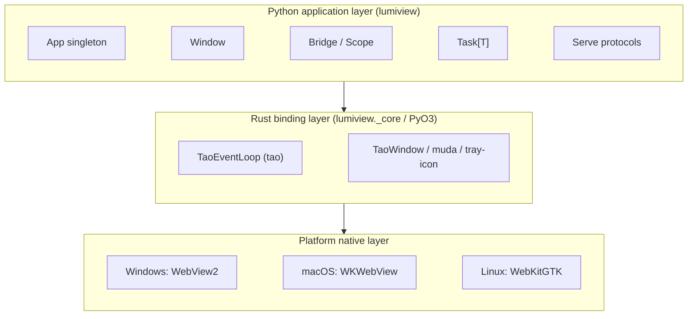

# Architecture, thread model and Task concurrency

## Layered architecture



- **Rust layer (`lumiview._core`)**: built on PyO3 `0.30` (declared with `#[pymodule(gil_used = false)]`, compatible with Python free-threading builds that have no GIL). Native handles (`TaoEventLoop`, `TaoWindow`, `TaoMenu`, `TaoTrayIcon`, and so on) are all `unsendable` and must never cross a thread boundary; before the dispatch loop enters Python, the Rust side filters out high-frequency mouse moves, raw key presses and frame-tick events through `is_python_event()`, so there is no needless GIL contention.
- **Python layer (`lumiview`)**: exposes only thread-safe wrapper objects (`App`, `Window`, `Menu`, `TrayIcon`, and so on); every low-level call is routed back to the main thread automatically, so you never manage native handle ownership by hand.

---

## The 2+N thread model

| Thread | Responsibility | When does your code run there? |
|---|---|---|
| **Main thread (GUI thread)** | Runs the `tao` native event loop and handles native window / menu / tray / WebView operations | Only when you schedule it explicitly through `app.call_on_main(...)`, `@main_thread` or `WindowOptions(prepare=...)` |
| **asyncio thread** | Runs the single `asyncio` event loop | `app.run(async_entry)`, `async def` event handlers, `async def` Bridge commands, `async def` ASGI / `Handler` |
| **Thread pool (N workers)** | Runs blocking synchronous logic without stalling the event loop or the UI | `app.run(sync_entry)`, plain `def` event handlers, plain `def` Bridge commands, `WSGI` apps, `task(sync_fn)` |

> **Key principle**: **event handlers and Bridge commands never block the GUI main thread** (except for the few native synchronous interception callbacks covered in the next chapter). You can safely make network requests or run expensive computations inside a callback.

---

## `Task[T]`: one handle for async and sync

`Task` subclasses `concurrent.futures.Future` and implements `__await__`, so it supports three consumption styles — awaiting, blocking and callback notification:

```python
# 1. In an async function (the asyncio thread or any thread with a running loop)
title = await win.eval_js("document.title")

# 2. On a plain sync thread (a pool thread or a third-party background thread)
title = win.eval_js("document.title").result(timeout=5.0)

# 3. Non-blocking callbacks
t = win.eval_js("document.title")
t.on_done(lambda val: print("ok:", val))
t.on_exception(lambda exc: print("failed:", exc))
```

### Non-blocking timeout: `Task.with_timeout()`

`t.result(timeout=...)` blocks the current thread. To add a timeout to a `Task` from async code, or to avoid cancelling the underlying task (for example when several consumers share one waiter), use `with_timeout()`:

```python
# Raises TimeoutError on timeout, but the source Task keeps running to completion
title = await win.eval_js("slowWork()").with_timeout(2.0, message="JS execution timed out")
```

### Deadlock protection: `TaskDeadlockError`

Calling `.result()` on a pending `Task` **on the asyncio thread** raises `TaskDeadlockError` immediately:

```python
async def bad_handler():
    # ❌ Wrong: this hangs the entire asyncio loop, stalling every coroutine and event callback
    win.eval_js("1 + 1").result()

    # ✅ Right: use await
    await win.eval_js("1 + 1")
```

> **Note**: when `.result()` is called on a pending `Task` from the **GUI main thread**, `Task._block_on_gui()` keeps draining the main-thread command queue (`_drain_commands()`) while it waits, so the awaited command itself can run and no deadlock occurs (the UI briefly freezes while waiting, though).

### Unretrieved `Task` exceptions

If you start a `Task` and never `await` it, never call `.result()` on it and never register `.on_exception()`, and it fails, the `lumiview.task` logger prints the full ERROR-level traceback once the `Task` is garbage-collected (`__del__`) with the exception still unread — no failure is swallowed silently.

---

## Concurrency helpers

### `task(fn, *args, **kwargs)`

Submits any function to LumiView's scheduler and returns a `Task[T]` (sync vs. async is detected automatically, and the caller's `contextvars` are copied and propagated):

```python
from lumiview import task


def heavy_cpu_job(n: int) -> int:
    return sum(range(n))


async def async_job(url: str) -> str:
    ...


async def main():
    # Sync function → thread pool; async function → asyncio thread
    total = await task(heavy_cpu_job, 10_000_000)
```

- Calling `task()` before `App.run()` returns a `Task` that fails with `RuntimeError`.
- Calling `task()` after the app has shut down (`STOPPED`) returns a `Task` that fails with `AppClosedError`.

### Main-thread scheduling: `app.call_on_main` and `@main_thread`

If you are integrating a third-party native library — a **tkinter file dialog**, **macOS AppKit / pyobjc**, a **Linux GTK widget** — it must be called on the system main thread:

```python
from lumiview import App
from lumiview.utils import main_thread


# Option A: use app.call_on_main
def pick_file_dialog() -> str:
    import tkinter as tk
    from tkinter import filedialog

    root = tk.Tk()
    root.withdraw()
    path = filedialog.askopenfilename()
    root.destroy()
    return path


async def on_open_clicked():
    path = await App.get().call_on_main(pick_file_dialog)
    print("picked file:", path)


# Option B: wrap the helper in @main_thread — calling it returns a Task
@main_thread
def bring_app_to_front():
    from AppKit import NSApp
    NSApp.activateIgnoringOtherApps_(True)
```
