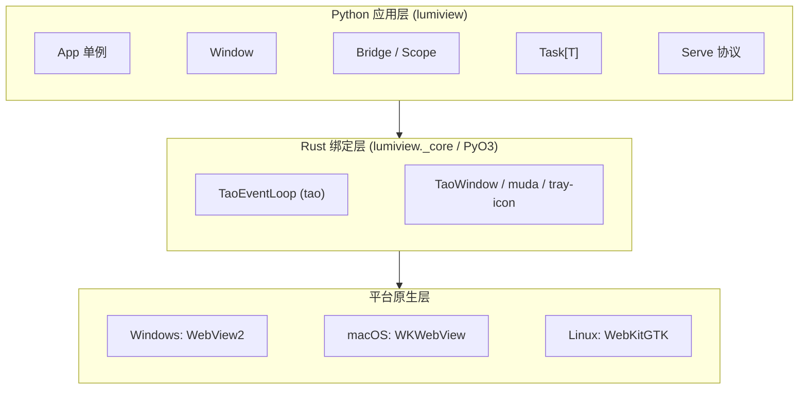

# 架构、线程模型与 Task 并发

## 分层架构



- **Rust 层 (`lumiview._core`)**：基于 PyO3 `0.30`（声明 `#[pymodule(gil_used = false)]`，兼容 Python Free-threading 无 GIL 模式）。原生句柄（`TaoEventLoop`、`TaoWindow`、`TaoMenu`、`TaoTrayIcon` 等）均为 `unsendable`，严禁跨线程传递；在分发循环进入 Python 前，Rust 侧会先通过 `is_python_event()` 过滤掉高频鼠标移动、原始按键和帧周期事件，不产生无谓的 GIL 争用。
- **Python 层 (`lumiview`)**：对外只暴露线程安全的包装对象（`App`、`Window`、`Menu`、`TrayIcon` 等），所有底层调用都会自动路由回主线程，无需用户手动管理原生句柄归属。

---

## 2+N 线程模型

| 线程 | 职责 | 你写的代码何时运行在这里？ |
|---|---|---|
| **主线程（GUI 线程）** | 运行 `tao` 原生事件循环、处理窗口/菜单/托盘/WebView 原生操作 | 仅通过 `app.call_on_main(...)`、`@main_thread` 或 `WindowOptions(prepare=...)` 显式调度时 |
| **asyncio 线程** | 运行唯一的 `asyncio` 事件循环 | `app.run(async_entry)`、`async def` 事件处理器、`async def` Bridge 命令、`async def` ASGI/Handler |
| **线程池（N 个 Worker）** | 运行阻塞的同步逻辑，避免卡死事件循环与界面 | `app.run(sync_entry)`、普通 `def` 事件处理器、普通 `def` Bridge 命令、`WSGI` 应用、`task(sync_fn)` |

> **关键原则**：**事件处理器和 Bridge 命令永远不会阻塞 GUI 主线程**（除了少数原生同步拦截回调，详见下一章）。因此你可以放心在回调中执行网络请求或耗时计算。

---

## `Task[T]`：统一的异步/同步句柄

`Task` 继承自 `concurrent.futures.Future` 并实现了 `__await__`，它同时兼容异步等待、阻塞获取和回调通知三种消费方式：

```python
# 1. 在 async 函数中（asyncio 线程或任意运行着事件循环的线程）
title = await win.eval_js("document.title")

# 2. 在普通同步线程（如线程池线程或第三方后台线程）
title = win.eval_js("document.title").result(timeout=5.0)

# 3. 非阻塞回调
t = win.eval_js("document.title")
t.on_done(lambda val: print("成功:", val))
t.on_exception(lambda exc: print("失败:", exc))
```

### 非阻塞超时：`Task.with_timeout()`

`t.result(timeout=...)` 会阻塞当前线程；如果在异步代码中需要给 `Task` 加超时，或者不想取消底层原本的任务（例如多个消费者共享同一个等待器），请使用 `with_timeout()`：

```python
# 超时后会抛出 TimeoutError，但原 Task 仍会继续完成
title = await win.eval_js("slowWork()").with_timeout(2.0, message="JS 执行超时")
```

### 死锁保护：`TaskDeadlockError`

在 **asyncio 线程**中对一个尚未完成的 `Task` 调用 `.result()` 会直接抛出 `TaskDeadlockError`：

```python
async def bad_handler():
    # ❌ 错误：这会卡死整个 asyncio 循环，导致所有协程和事件回调停滞
    win.eval_js("1 + 1").result()

    # ✅ 正确：使用 await
    await win.eval_js("1 + 1")
```

> **注**：如果当前是在 **GUI 主线程**上对未完成的 `Task` 调用 `.result()`，`Task._block_on_gui()` 会在等待期间持续排空主线程命令队列（`_drain_commands()`），保证被等待的命令本身能顺利执行而不死锁（但等待期间界面会短暂冻结）。

### 未处理的 `Task` 异常提醒

如果你发起了一个 `Task` 却既不 `await`、不调用 `.result()`、也不注册 `.on_exception()`，一旦该 `Task` 失败并在垃圾回收（`__del__`）时仍未被读取异常，`lumiview.task` logger 会自动打印完整的 ERROR 级别 traceback，避免静默吞错。

---

## 并发调度工具

### `task(fn, *args, **kwargs)`

将任意函数提交给 LumiView 调度并返回 `Task[T]`（自动判断同步/异步，并自动复制传播调用方的 `contextvars`）：

```python
from lumiview import task


def heavy_cpu_job(n: int) -> int:
    return sum(range(n))


async def async_job(url: str) -> str:
    ...


async def main():
    # 同步函数 → 线程池；异步函数 → asyncio 线程
    total = await task(heavy_cpu_job, 10_000_000)
```

- 在 `App.run()` 之前调用 `task()` 会返回以 `RuntimeError` 失败的 `Task`。
- 在应用关闭（`STOPPED`）之后调用 `task()` 会返回以 `AppClosedError` 失败的 `Task`。

### 主线程调度：`app.call_on_main` 与 `@main_thread`

如果你在集成第三方原生库（例如 **tkinter 文件选择框**、**macOS AppKit / pyobjc**、**Linux GTK 组件**），这些库要求必须在系统主线程调用：

```python
from lumiview import App
from lumiview.utils import main_thread


# 方式 A：使用 app.call_on_main
def pick_file_dialog() -> str:
    import tkinter as tk
    from tkinter import filedialog

    root = tk.Tk()
    root.withdraw()
    path = filedialog.askopenfilename()
    root.destroy()
    return path


async def on_open_clicked():
    path = await App.get().call_on_main(pick_file_dialog)
    print("选中文件:", path)


# 方式 B：用 @main_thread 包装工具函数，调用后直接返回 Task
@main_thread
def bring_app_to_front():
    from AppKit import NSApp
    NSApp.activateIgnoringOtherApps_(True)
```
